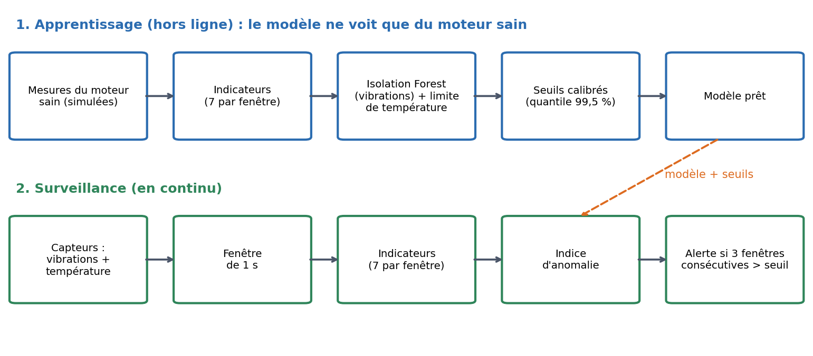
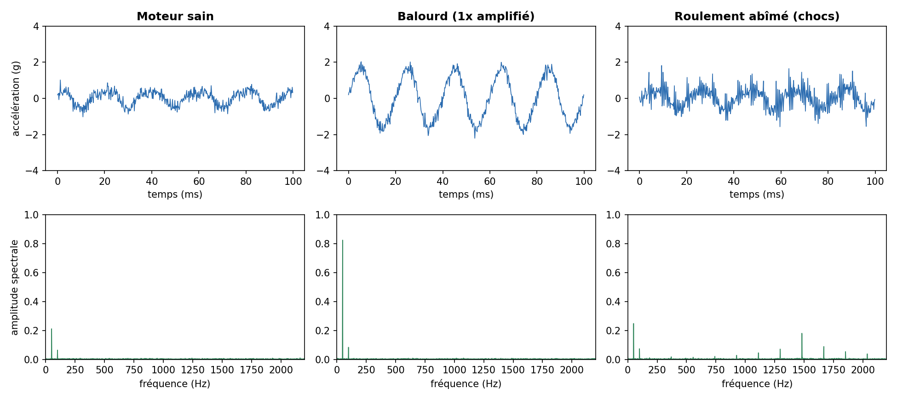
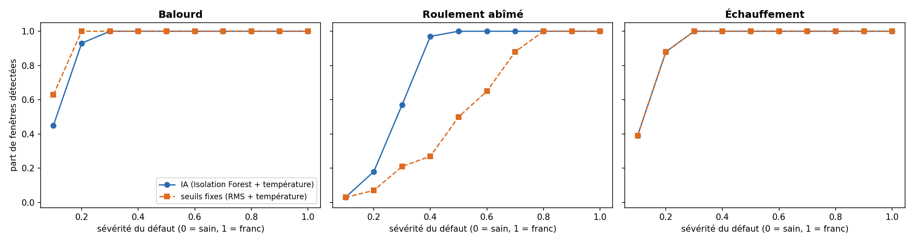
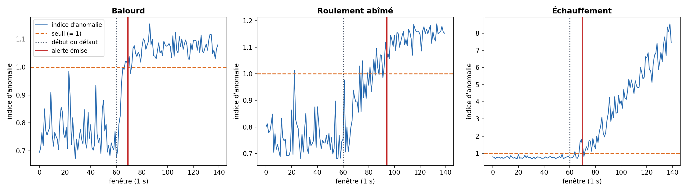

# Maintenance prédictive d'un moteur électrique par IA

Système qui surveille un moteur électrique à partir de **vibrations** (accéléromètre) et de sa **température**, apprend ce qu'est un fonctionnement normal, puis **émet une alerte** quand les mesures s'en écartent de façon durable.


> **À lire d'abord :** les mesures sont **simulées** (aucun moteur réel n'a été instrumenté). Ce projet valide la chaîne complète (mesure, indicateurs, IA, alerte) et la méthode d'évaluation. Les résultats ci-dessous ne disent rien des performances sur un vrai moteur.

## 1. Le problème

Un moteur qui tombe en panne arrête une ligne de production. Une maintenance à intervalles fixes gaspille des interventions, et attendre la panne coûte plus cher. La maintenance prédictive consiste à **détecter tôt** les signes d'une dégradation (vibrations anormales, échauffement) pour intervenir au bon moment.

## 2. Principe général



Le modèle est entraîné **uniquement sur du fonctionnement sain** : on ne dispose presque jamais d'exemples de pannes en industrie, donc on apprend à reconnaître le normal et on signale tout ce qui s'en éloigne. Cette approche s'appelle la détection d'anomalies non supervisée.

## 3. Les données (simulées)

Chaque mesure est une fenêtre de 1 s : vibrations échantillonnées à 5 kHz et une température. Le moteur tourne à 3000 tr/min (50 Hz). La charge varie d'une fenêtre à l'autre, pour que le « sain » ne soit pas un signal parfaitement constant.

Trois défauts sont simulés, chacun avec une **sévérité** de 0 (sain) à 1 (défaut franc) :

| Défaut | Effet simulé | Ce qui change dans la mesure |
|---|---|---|
| Balourd (déséquilibre) | composante à la fréquence de rotation amplifiée | énergie à 50 Hz et RMS en hausse |
| Roulement abîmé | chocs périodiques excitant une résonance à 1,5 kHz | kurtosis, facteur de crête et énergie haute fréquence en hausse |
| Échauffement | dérive de la température jusqu'à +18 °C | température en hausse |



Le roulement abîmé est le cas intéressant : sur la courbe temporelle les chocs se noient dans le bruit, alors que le spectre montre une bosse vers 1,5 kHz.

## 4. Les indicateurs

Le signal brut est résumé en 7 nombres par fenêtre :

| Indicateur | Pourquoi |
|---|---|
| RMS | niveau global de vibration |
| Facteur de crête | rapport pic/RMS : grand quand il y a des chocs |
| Kurtosis | vaut environ 3 pour du bruit, augmente avec des impulsions |
| Énergie à 1x (45-55 Hz) | signature du balourd |
| Énergie à 2x (95-105 Hz) | harmonique, utile pour d'autres défauts d'alignement |
| Énergie haute fréquence (1-2 kHz) | signature des défauts de roulement |
| Température | échauffement du bobinage |

## 5. Le modèle et l'alerte

- **Vibrations** : une *Isolation Forest* (scikit-learn) sur les 6 indicateurs vibratoires. Elle isole les points rares en les séparant par des coupures aléatoires : un point anormal est isolé en peu de coupures.
- **Température** : écart au niveau normal, rapporté à une limite calibrée sur du sain.
- Les deux voies sont ramenées à un **indice d'anomalie** (1 = seuil) et on garde le maximum. Chaque seuil est calibré au quantile 99,5 % d'un jeu de validation sain, donc environ 0,5 % de fausses alarmes par fenêtre.
- **Logique d'alerte** : une fenêtre au-dessus du seuil passe en `SURVEILLANCE`, et l'alerte `ALERTE` n'est émise qu'après **3 fenêtres consécutives** anormales. Une anomalie isolée (parasite, pic de charge) ne déclenche donc rien.

### Choix de conception : pourquoi la température est à part

Dans une première version, les 7 indicateurs allaient tous dans l'Isolation Forest. Résultat : seulement 5 % des fenêtres en échauffement franc étaient détectées. Une dérive sur **une seule** variable est diluée parmi 7, car la plupart des coupures aléatoires tombent sur d'autres variables. Séparer la température et la traiter par sa propre limite a réglé le problème.

## 6. Résultats (données simulées, graine fixe)

Comparaison avec une référence classique : **seuils fixes sur le RMS et sur la température** (calibrés de la même façon). Sur 300 fenêtres saines de test, les deux approches donnent 0,7 % de fausses alarmes.



| Défaut | Ce que l'on observe |
|---|---|
| Roulement abîmé | **L'IA gagne nettement** : plus de 95 % des fenêtres détectées dès la sévérité 0,4, contre 27 % pour les seuils fixes (ils n'atteignent 88 % qu'à 0,7). Les chocs changent le kurtosis et l'énergie haute fréquence bien avant le RMS. |
| Balourd | **Pas de gain** : le balourd se voit directement sur le RMS, et les seuils fixes sont même légèrement meilleurs aux très faibles sévérités (63 % contre 45 % à 0,1). |
| Échauffement | **Équivalent** : les deux approches utilisent la même limite de température. |

L'IA ne bat donc pas les seuils partout : elle apporte un vrai gain là où le défaut ne se voit pas sur le niveau global.

### Scénario de dégradation progressive

Moteur sain pendant 60 fenêtres, puis un défaut qui s'aggrave régulièrement pendant 80 fenêtres.



| Défaut | Alerte IA | Alerte seuils fixes |
|---|---|---|
| Balourd | fenêtre 69 (sévérité 0,13) | fenêtre 66 (sévérité 0,09) |
| Roulement abîmé | fenêtre 94 (sévérité 0,44) | fenêtre 107 (sévérité 0,60) |
| Échauffement | fenêtre 70 (sévérité 0,14) | fenêtre 70 (sévérité 0,14) |

Pas de fausse alerte avant le début du défaut dans ces trois scénarios. Chaque ligne vient d'**une seule** simulation : elle illustre le comportement mais ne remplace pas une étude statistique sur de nombreux tirages. Les chiffres complets sont dans `results/metrics.json`.

## 7. Utilisation

```bash
git clone https://github.com/<ton-pseudo>/motor-predictive-maintenance.git
cd motor-predictive-maintenance
python -m venv .venv
source .venv/bin/activate        # Windows : .venv\Scripts\activate
pip install -r requirements.txt

python -m pytest -v              # 19 tests
python -m pmaint.experiment      # régénère les figures et results/metrics.json
python -m pmaint.demo --fault bearing   # démonstration avec émission d'alerte
```

Exemple de sortie de la démonstration :

```
fenêtre  81 | indice 1.03 | sévérité du défaut 0.28 | état : SURVEILLANCE
fenêtre  90 | indice 1.08 | sévérité du défaut 0.39 | état : ALERTE
>>> ALERTE : maintenance à prévoir sur le moteur
```

## 8. Structure

```
pmaint/simulate.py     génération des mesures saines et défectueuses
pmaint/features.py     calcul des 7 indicateurs
pmaint/model.py        détecteur (Isolation Forest + température) et référence à seuils
pmaint/alert.py        logique NORMAL / SURVEILLANCE / ALERTE
pmaint/pipeline.py     chaîne complète sur un flux de fenêtres
pmaint/train.py        entraînement sur moteur sain
pmaint/experiment.py   évaluation, figures, métriques
pmaint/demo.py         démonstration en flux
tests/                 tests unitaires et de bout en bout
docs/                  schémas et courbes du README
```

## 9. Limites

- Données simulées : un vrai moteur a des bruits, des régimes et des dérives que la simulation ne reproduit pas.
- Le système **détecte** une anomalie mais ne **diagnostique** pas son type (balourd, roulement, etc.).
- Un seul régime de fonctionnement (3000 tr/min) : une vitesse variable demanderait un modèle par régime ou des indicateurs normalisés par la vitesse.

## 10. Perspectives

- Valider sur des **données réelles** de vibrations (jeux publics de roulements comme celui de la Case Western Reserve University).
- Embarquer l'acquisition sur un **ESP32** avec un accéléromètre et une sonde de température, et envoyer les fenêtres au PC par le port série.
- Ajouter un classifieur de type de défaut une fois des exemples étiquetés disponibles.

## Auteure

Laurette Seri, Master 2 CSEC, Université de Lorraine. Licence MIT.
